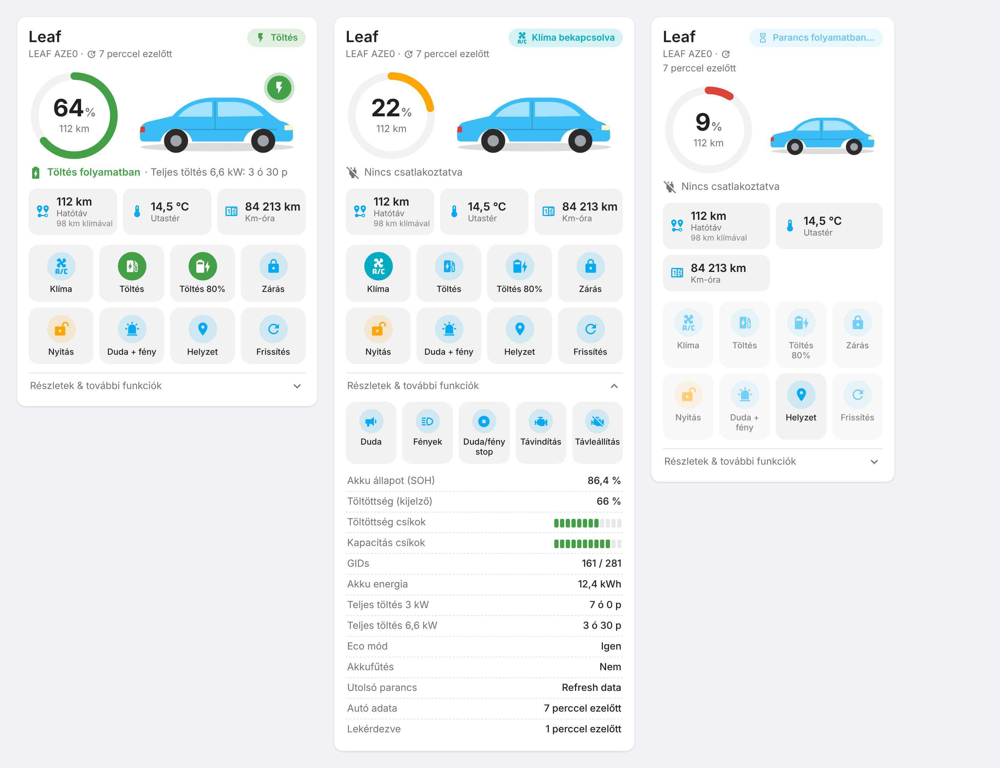
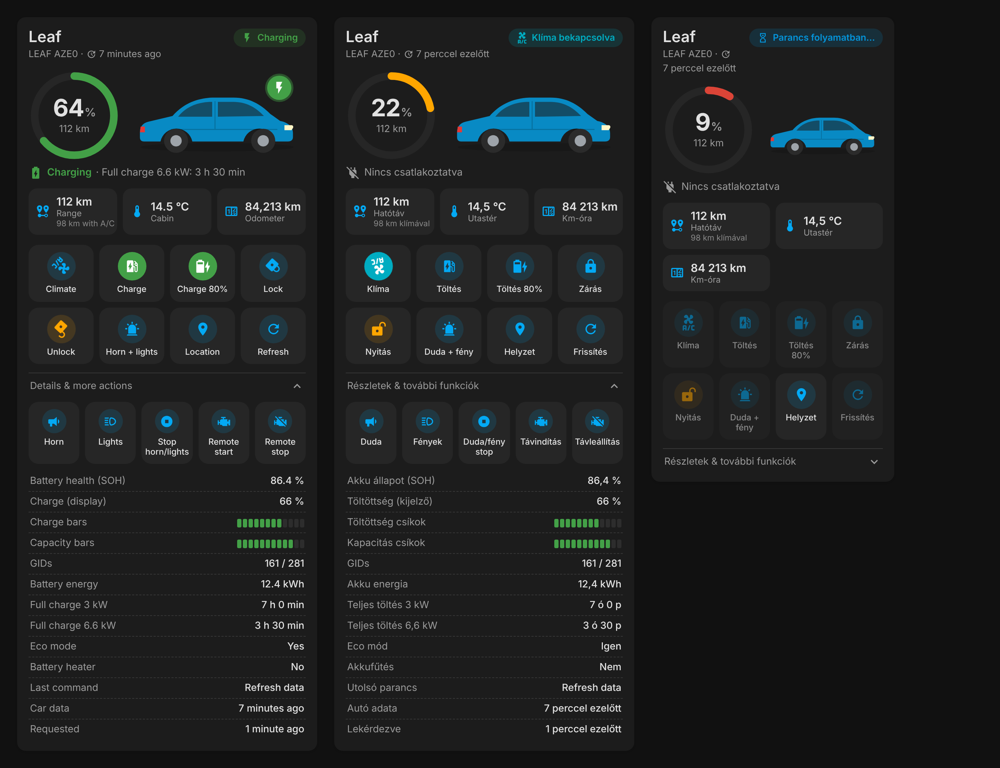

# OpenCARWINGS Card

[](https://github.com/hacs/integration)

Lovelace kártya OpenCARWINGS integrációkhoz (Nissan LEAF / e-NV200). Támogatott integrációk:

- [drrcastro/OCW](https://github.com/drrcastro/OCW) – „OpenCarWings” (`ocw_integration`)
- [czapeczek/ha_opencarwings](https://github.com/czapeczek/ha_opencarwings) – „OpenCARWINGS Integration” (`ha_opencarwings`)
Egy kártyán minden fontos dolog: töltöttség, hatótáv, töltés, klíma, zárás/nyitás, duda/fény, helyzet és frissítés.

*Lovelace card for the ha_opencarwings integration. Hungarian and English UI (follows the HA language).*




## Funkciók

- **Automatikusan megtalálja az autó entitásait** – nem kell entitásokat beírni
- Töltöttség kör (színe változik: zöld / sárga 30% alatt / piros 15% alatt), hatótáv klímával és anélkül
- Állapot címke: Töltés, Gyorstöltés, Klíma bekapcsolva, Üzemben, Akkufűtés, Parancs folyamatban…
- Töltőkábel állapota és a becsült teljes töltési idő
- **Gombok:** Klíma (be/ki), Töltés, Töltés 80%, Zárás, Nyitás, Duda + fény, Helyzet, Frissítés
- **További funkciók** (lenyitható): Duda, Fények, Duda/fény stop, Távindítás, Távleállítás
- **Részletek:** SOH, akku csíkok, GIDs, kWh, töltési idők, Eco mód, akkufűtés, guminyomás, hibakódok (DTC), szerviz figyelmeztetés, térerő, frissítés ideje
- Kockázatos parancsok (Nyitás, Duda) **dupla érintéssel** mennek, így nem nyomod meg véletlenül
- Opcionális térkép az autó helyzetével
- Világos és sötét téma, mobilon is jól mutat, vizuális szerkesztő
- Csak a meglévő gombok jelennek meg (amit az autód nem tud, azt elrejti)

## Telepítés

### HACS (ajánlott)

1. HACS → jobb felső ⋮ → **Egyéni tárolók (Custom repositories)**
2. Tároló: `https://github.com/<FELHASZNÁLÓNEVED>/opencarwings-card`, típus: **Dashboard** (régebbi HACS-ban: *Lovelace / Plugin*)
3. Keresd meg: **OpenCARWINGS Card** → Letöltés
4. Frissítsd a böngészőt (Ctrl+F5 / mobil appban: Beállítások → Gyorsítótár ürítése)

### Kézi telepítés

1. Másold a `dist/opencarwings-card.js` fájlt ide: `<config>/www/opencarwings-card.js`
2. Beállítások → Irányítópultok → ⋮ → **Erőforrások** → Erőforrás hozzáadása
   - URL: `/local/opencarwings-card.js`
   - Típus: **JavaScript modul**
3. Frissítsd a böngészőt

### Csak YAML (telepítés nélkül)

Ha nem akarsz egyéni kártyát telepíteni, az [`examples/yaml-only-card.yaml`](examples/yaml-only-card.yaml)
csak beépített HA kártyákat használ. Másold be kézi kártyaként, és cseréld ki benne a `leaf` szót az autód becenevére.

## Használat

Irányítópult szerkesztése → **+ Kártya hozzáadása** → keresd: **OpenCARWINGS Card**. Vagy YAML-ben:

```yaml
type: custom:opencarwings-card
```

Ennyi elég, a kártya magától megtalálja az autót. Minden beállítás:

```yaml
type: custom:opencarwings-card
device_id: 0123456789abcdef      # ha több autód van (vagy: vin: SJNFAAZE0U1234567)
name: Kis Leaf                  # saját név
image: /local/leaf.png          # egyetlen saját kép (vagy lásd lent: images)
show_map: true                  # térkép a kártya alján
show_details: false             # részletek alapból nyitva
confirm_actions: true           # nyitás/duda dupla érintéssel
language: hu                    # hu / en (alapból a HA nyelve)
entities:                       # csak ha valamit kézzel felül akarsz írni
  soc: sensor.leaf_state_of_charge
  ac: switch.leaf_a_c
```

Az `entities` alatt használható kulcsok: `soc`, `soh`, `range_acon`, `range_acoff`, `plugged_in`, `charging`,
`quick_charging`, `ac_status`, `cabin_temp`, `odometer`, `status`, `last_updated`, `ac`, `tracker`,
`car_chargestart`, `car_chargestart80`, `car_doorlock`, `car_doorunlock`, `car_horn`, `car_lights`,
`car_horn_lights`, `car_stop_horn_lights`, `car_remote_start`, `car_remote_stop`, `car_refresh`.

## Saját autófotók

A kártya minden állapothoz más képet mutathat, és finoman áttűnik közöttük. Töltés közben zöld fény dereng a kép mögött, bekapcsolt klímánál ciánkék.

1. Másold a képeket ide: `<config>/www/opencarwings/`. Átlátszó hátterű PNG vagy WebP a legszebb.
2. Add meg őket a kártyában. Ha valamelyiket kihagyod, az alap kép jelenik meg helyette.

```yaml
type: custom:opencarwings-card
images:
  default: /local/opencarwings/leaf-main.webp      # parkolás
  charging: /local/opencarwings/leaf-charging.webp # töltés közben
  plugged: /local/opencarwings/leaf-charging.webp  # csatlakoztatva (alapból a charging képet használja)
  climate: /local/opencarwings/leaf-top.webp       # klíma bekapcsolva
  running: /local/opencarwings/leaf-main.webp      # üzemben
```

> A gyári Nissan fotók szerzői jog alatt állnak. Saját Home Assistantedben nyugodtan használhatod őket,
> de ne töltsd fel őket ebbe a nyilvános tárolóba. Kép nélkül a kártya a beépített rajzot mutatja.

## Hasznos tudnivalók

- A parancsok (klíma, töltés, zárás…) az OpenCARWINGS szerveren keresztül jutnak el az autóhoz, ez **1-2 percig is tarthat**.
  Közben a címke azt mutatja: *Parancs folyamatban…*
- A klíma gomb állapotát az autó `AC Status` szenzorából veszi, mert az integráció kapcsolója nem kap visszajelzést az autótól.
- Az entitásokat a kártya az entitás-regiszter alapján (unique_id) azonosítja. Ha a felhasználó nem admin,
  akkor az entitásnevek alapján keres. Ha átnevezted az entitásokat, és valami nem jelenik meg, add meg az `entities` alatt.

## Licenc

MIT
